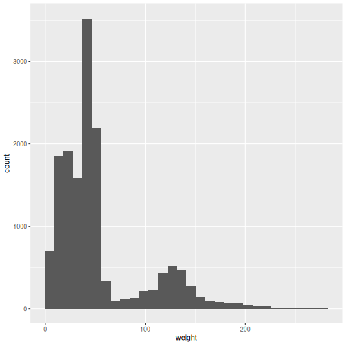
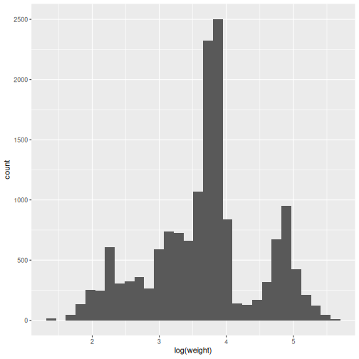
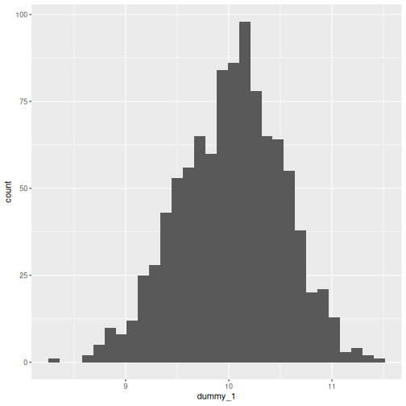
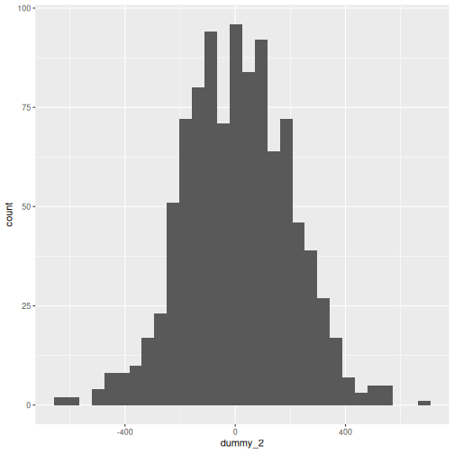
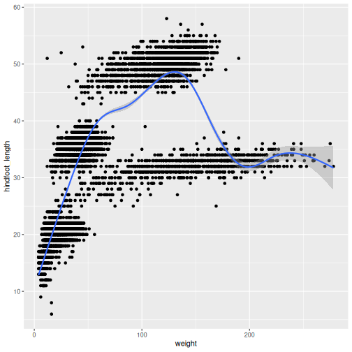

::::::::::::::::::::::::::::::::::::::: objectives

- To be able to describe the different types of data
- To be able to do basic data exploration of a dataset
- To be able to calculate descriptive statistics
- To be able to perform statistical inference on a dataset

::::::::::::::::::::::::::::::::::::::::::::::::::

:::::::::::::::::::::::::::::::::::::::: questions

- How can I detect the type of data I have?
- How can I make meaningful summaries of my data?

::::::::::::::::::::::::::::::::::::::::::::::::::

## Content

-   Types of Data
-   Exploring your dataset
-   Descriptive Statistics
-   Inferential Statistics

## Data

Up until this point, we have been working with the complete_old dataframe contained in the ratdat package. However, you typically won’t access data from an R package; it is much more common to access data files stored somewhere on your computer. We are now going to start using the data in our cleaned directory inside the data directory that you downloaded at the beginning of the lesson (instructions here). This file is called surveys_complete_77_89.csv.


``` r
# We will need these libraries and this data later.
library(tidyverse)

#tidyverse is a large package that incorporates other packages

# loading data
surveys <- read.csv("data/cleaned/surveys_complete_77_89.csv")
```

## The big picture

-   Research often seeks to answer a question about a larger population by collecting data on a small sample
-   Data collection:
    -   Many variables
    -   For each person/unit.
-   This procedure, *sampling*, must be controlled so as to ensure **representative** data.

## Descriptive and inferential statistics

::: callout
Just as data in general are of different types - for example numeric vs text data - statistical data are assigned to different *levels of measure*. The level of measure determines how we can describe and model the data.
:::

# Describing data

-   Continuous variables
-   Discrete variables

::: callout
How do we convey information on what your data looks like, using numbers or figures?
:::

### Describing continuous data.

First establish the distribution of the data. You can visualise this with a histogram.


``` r
ggplot(surveys, aes(x = weight)) +
  geom_histogram()
```

``` output
`stat_bin()` using `bins = 30`. Pick better value `binwidth`.
```

``` warning
Warning: Removed 1692 rows containing non-finite outside the scale range
(`stat_bin()`).
```


What is the distribution of this data?

### What is the distribution of population?

If the raw values are difficult to visualise, so we can take the log of the values and log those.  Try this command


``` r
ggplot(surveys, aes(x = log(weight))) +
  geom_histogram()
```

``` output
`stat_bin()` using `bins = 30`. Pick better value `binwidth`.
```

``` warning
Warning: Removed 1692 rows containing non-finite outside the scale range
(`stat_bin()`).
```


What is the distribution of this data?

## Parametric vs non-parametric analysis

-   Parametric analysis assumes that
    -   The data follows a known distribution
    -   It can be described using *parameters*
    -   Examples of distributions include, normal, Poisson, exponential.
-   Non parametric data
    -   The data can't be said to follow a known distribution

::::::::::::::::::::::::::::::::::::: instructor
Emphasise that parametric is not equal to normal.
::::::::::::::::::::::::::::::::::::::::::::::::

### Describing parametric and non-parametric data

How do you use numbers to convey what your data looks like.

-   Parametric data
    -   Use the parameters that describe the distribution.
    -   For a Gaussian (normal) distribution - use mean and standard deviation
    -   For a Poisson distribution - use average event rate
    -   etc.
-   Non Parametric data
    -   Use the median (the middle number when they are ranked from lowest to highest) and the interquartile range (the number 75% of the way up the list when ranked minus the number 25% of the way)
-   You can use the command `summary(data_frame_name)` to get these numbers for each variable.

## Mean versus standard deviation

-   What does standard deviation mean?
-   Both graphs have the same mean (center), but the second one has data which is more spread out.


``` r
# small standard deviation
dummy_1 <- rnorm(1000, mean = 10, sd = 0.5)
dummy_1 <- as.data.frame(dummy_1)
ggplot(dummy_1, aes(x = dummy_1)) +
  geom_histogram()
```

``` output
`stat_bin()` using `bins = 30`. Pick better value `binwidth`.
```



``` r
# larger standard deviation
dummy_2 <- rnorm(1000, mean = 10, sd = 200)
dummy_2 <- as.data.frame(dummy_2)
ggplot(dummy_2, aes(x = dummy_2)) +
  geom_histogram()
```

``` output
`stat_bin()` using `bins = 30`. Pick better value `binwidth`.
```



::::::::::::::::::::::::::::::::::::: instructor
Get them to plot the graphs. Explain that we are generating random data from different distributions and plotting them.
::::::::::::::::::::::::::::::::::::::::::::::::

### Calculating mean and standard deviation


``` r
mean(surveys$weight) 
```

``` output
[1] NA
```

``` r
#by default it does not ignore missing values

mean(surveys$weight, na.rm = TRUE)
```

``` output
[1] 53.21665
```
Although this is cleaned data, it still contains missing values.

The `na.rm = TRUE` argument tells R to ignore missing values in the variable.

It may be preferable to use a version of the data with records containing missing values removed.


``` r
#Create a reduced data set containing only complete records

cleaned_complete<-na.omit(surveys)

 # we can now compute the mean without using na.rm = TRUE
mean(cleaned_complete$weight)
```

``` output
[1] 52.34551
```

Calculate the standard deviation and confirm that it is the square root of the variance:


``` r
sdweight <- sd(cleaned_complete$weight)
print(sdweight)
```

``` output
[1] 43.71923
```

``` r
varweight <- var(cleaned_complete$weight)
print(varweight)
```

``` output
[1] 1911.371
```

``` r
sqrt(varweight) == sdweight
```

``` output
[1] TRUE
```

### Calculating median and interquartile range


``` r
median(cleaned_complete$weight)
```

``` output
[1] 42
```

``` r
IQR(cleaned_complete$weight)
```

``` output
[1] 28
```
Notice that IQR only returns the 25% quartile. It utilises the `quantile()` function.

## Describing discrete data

In our data set there is a variable `sex`.What is the proportion of males and females in this data set?

-   Frequencies


``` r
table(cleaned_complete$sex)
```

``` output

        F    M 
  24 6477 7296 
```
-   Proportions


``` r
gendertable <- table(cleaned_complete$sex)
prop.table(gendertable)
```

``` output

                      F           M 
0.001739509 0.469449880 0.528810611 
```

Contingency tables of frequencies can also be tabulated with **table()**. For example:


``` r
table(
  cleaned_complete$plot_id,
  cleaned_complete$species_id
)
```

``` output
    
      BA  DM  DO  DS  NL  OL  OT  OX  PE  PF  PH  PM  PP  RF  RM  SF  SH
  1    0 338 139 196  34  33  30   0   7  13   0  10  24   0  14   0   0
 [ reached 'max' / getOption("max.print") -- omitted 23 rows ]
```
Which leads quite naturally to the consideration of any association between the observed frequencies.

A Chi Square could be used to determine if the distribution of species across the different plots was statistically significant.


``` r
# create the contingency table
contingency_table <- table(
    cleaned_complete$plot_id,
    cleaned_complete$species_id
  )

# perform chi square test
chi_square_test <- chisq.test(contingency_table)
```

``` warning
Warning in chisq.test(contingency_table): Chi-squared approximation may be
incorrect
```

``` r
#View results
print(chi_square_test)
```

``` output

	Pearson's Chi-squared test

data:  contingency_table
X-squared = 9130.5, df = 368, p-value < 2.2e-16
```
Learn more about the Chi-Squared test: [Wikipedia - Chi-Squared Test](https://en.wikipedia.org/wiki/Chi-squared_test)

# Inferential statistics

## Meaningful analysis

-   What is your hypothesis - what is your null hypothesis?

::: callout
Always: the level of the independent variable has no effect on the level of the dependent variable.
:::

-   What type of variables (data type) do you have?

-   What are the assumptions of the test you are using?

-   Interpreting the result

## Testing significance

-   p-value

-   \<0.05

-   0.03-0.049

    -   Would benefit from further testing.

**0.05** is not a magic number.

## Comparing means

It all starts with a hypothesis

-   Null hypothesis
    -   "There is no difference in mean hindfoot length between males and females" $$mean\_height\_men - mean\_height\_women = 0$$
-   Alternate hypothesis
    -   "There is a difference in mean hindfoot length between males and females"

## More on hypothesis testing

-   The null hypothesis (H0) assumes that the true mean difference (μd) is equal to zero.

-   The two-tailed alternative hypothesis (H1) assumes that μd is not equal to zero.

-   The upper-tailed alternative hypothesis (H1) assumes that μd is greater than zero.

-   The lower-tailed alternative hypothesis (H1) assumes that μd is less than zero.

-   Remember: hypotheses are never about data, they are about the processes which produce the data. The value of μd is unknown. The goal of hypothesis testing is to determine the hypothesis (null or alternative) with which the data are more consistent.

## Comparing means

Let's use the hypothesis introduced above: is there is a difference in hind foot length between males and females?


``` r
cleaned_complete %>%
  group_by(sex) %>%
  summarise(mean = mean(hindfoot_length), n = n())
```

``` output
# A tibble: 3 × 3
  sex    mean     n
  <chr> <dbl> <int>
1 ""     25.7    24
2 "F"    31.7  6477
3 "M"    32.0  7296
```
Is the difference between the sexes statistically significant?

## t-test

### Assumptions of a t-test

-   One independent categorical variable with 2 groups and one dependent continuous variable

-   The dependent variable is approximately normally distributed in each group

-   The observations are independent of each other

-   For students' original t-statistic, that the variances in both groups are more or less equal. This constraint should probably be abandoned in favour of always using a conservative test.

## Doing a t-test


``` r
t.test(hindfoot_length ~ sex, data = cleaned_complete)
```

``` error
Error in `t.test.formula()`:
! grouping factor must have exactly 2 levels
```

``` r
# we can also specify specific components
t.test(hindfoot_length ~ sex, data = cleaned_complete)$statistic
```

``` error
Error in `t.test.formula()`:
! grouping factor must have exactly 2 levels
```

``` r
t.test(hindfoot_length ~ sex, data = cleaned_complete)$parameter
```

``` error
Error in `t.test.formula()`:
! grouping factor must have exactly 2 levels
```

Notice that the summary()** of the test contains more data than is output by default.

### t-test result

Testing supported the rejection of the null hypothesis that there is no difference between the hind foot length of males and females in this data set. 

(Can you get p to display to four places?  Cf *format()*.)

Learn more about the T-test test: [Wikipedia - Student's t-test](https://en.wikipedia.org/wiki/Student%27s_t-test)

## More than two levels of IV

While the t-test is sufficient where there are two levels of the IV, for situations where there are more than two, we use the **ANOVA** family of procedures. To show this, we will compare the `hindfoot_length` between `species_id` . 

Like the T-test, the ANOVA assumes independence of the observations. 
If the ANOVA result is statistically significant, we will use a post-hoc test method to do pairwise comparisons (here Tukey's Honest Significant Differences.)


``` r
anovamodel <- aov(cleaned_complete$hindfoot_length ~ cleaned_complete$species_id)

summary(anovamodel)
```

``` output
                               Df  Sum Sq Mean Sq F value Pr(>F)    
cleaned_complete$species_id    16 1548664   96791   45014 <2e-16 ***
Residuals                   13780   29631       2                   
---
Signif. codes:  0 '***' 0.001 '**' 0.01 '*' 0.05 '.' 0.1 ' ' 1
```

``` r
# we can test 
TukeyHSD(anovamodel)
```

``` output
  Tukey multiple comparisons of means
    95% family-wise confidence level

Fit: aov(formula = cleaned_complete$hindfoot_length ~ cleaned_complete$species_id)

$`cleaned_complete$species_id`
               diff         lwr          upr     p adj
DM-BA  22.971605679  20.0422207  25.90099065 0.0000000
DO-BA  22.435435435  19.5036327  25.36723818 0.0000000
DS-BA  37.016494845  34.0857247  39.94726501 0.0000000
NL-BA  19.314789688  16.3803287  22.24925069 0.0000000
OL-BA   7.569384835   4.6346005  10.50416919 0.0000000
OT-BA   7.249667995   4.3153334  10.18400261 0.0000000
OX-BA   7.400000000   3.6956994  11.10430056 0.0000000
 [ reached 'max' / getOption("max.print") -- omitted 129 rows ]
```
For more about ANOVA in R see:[Stats and R - ANOVA in R](https://statsandr.com/blog/anova-in-r/)

## Regression Modelling

The most common use of regression modelling is to explore the relationship between two continuous variables, for example between `weight` and `hindfoot_length` in our data. We can first determine whether there is any significant correlation between the values, and if there is, plot the relationship.


``` r
# Is there a correlation? Using Spearman
cor.test(cleaned_complete$weight, cleaned_complete$hindfoot_length,method="spearm")
```

``` warning
Warning in cor.test.default(cleaned_complete$weight,
cleaned_complete$hindfoot_length, : cannot compute exact p-value with ties
```

``` output

	Spearman's rank correlation rho

data:  cleaned_complete$weight and cleaned_complete$hindfoot_length
S = 9.2609e+10, p-value < 2.2e-16
alternative hypothesis: true rho is not equal to 0
sample estimates:
      rho 
0.7884321 
```

``` r
#What does it look like?
ggplot(cleaned_complete, aes(weight, hindfoot_length)) +
  geom_point() +
  geom_smooth()
```

``` output
`geom_smooth()` using method = 'gam' and formula = 'y ~ s(x, bs = "cs")'
```



Having decided that a further investigation of this relationship is worthwhile, we can create a linear model with the function `lm()`.


``` r
linear_model <- lm(cleaned_complete$weight ~ cleaned_complete$hindfoot_length)
summary(linear_model)
```

``` output

Call:
lm(formula = cleaned_complete$weight ~ cleaned_complete$hindfoot_length)

Residuals:
    Min      1Q  Median      3Q     Max 
-93.973 -19.761  -4.956   5.659 225.243 

Coefficients:
                                  Estimate Std. Error t value Pr(>|t|)    
(Intercept)                      -36.87101    0.85167  -43.29   <2e-16 ***
cleaned_complete$hindfoot_length   2.80087    0.02535  110.50   <2e-16 ***
---
Signif. codes:  0 '***' 0.001 '**' 0.01 '*' 0.05 '.' 0.1 ' ' 1

Residual standard error: 31.84 on 13795 degrees of freedom
Multiple R-squared:  0.4695,	Adjusted R-squared:  0.4695 
F-statistic: 1.221e+04 on 1 and 13795 DF,  p-value: < 2.2e-16
```

### Regression with a categorical IV (the t-test)

Run the following code chunk and compare the results to the t-test conducted earlier.


``` r
cleaned_complete %>%
  mutate(sex = factor(sex))
```

``` output
   record_id month day year plot_id species_id sex hindfoot_length weight
63        63     8  19 1977       3         DM   M              35     40
64        64     8  19 1977       7         DM   M              37     48
       genus  species   taxa                plot_type
63 Dipodomys merriami Rodent Long-term Krat Exclosure
64 Dipodomys merriami Rodent         Rodent Exclosure
 [ reached 'max' / getOption("max.print") -- omitted 13795 rows ]
```

``` r
cat_test <- lm(cleaned_complete$hindfoot_length ~ cleaned_complete$sex)

summary(cat_test)
```

``` output

Call:
lm(formula = cleaned_complete$hindfoot_length ~ cleaned_complete$sex)

Residuals:
    Min      1Q  Median      3Q     Max 
-26.036 -11.036   2.964   4.964  26.330 

Coefficients:
                      Estimate Std. Error t value Pr(>|t|)    
(Intercept)             25.708      2.183  11.779  < 2e-16 ***
cleaned_complete$sexF    5.961      2.187   2.726  0.00641 ** 
cleaned_complete$sexM    6.328      2.186   2.895  0.00380 ** 
---
Signif. codes:  0 '***' 0.001 '**' 0.01 '*' 0.05 '.' 0.1 ' ' 1

Residual standard error: 10.69 on 13794 degrees of freedom
Multiple R-squared:  0.0008675,	Adjusted R-squared:  0.0007227 
F-statistic: 5.989 on 2 and 13794 DF,  p-value: 0.002514
```
:::::::::::::::::::::::::::::::::::::::  challenge

### Challenge: Regression with a categorical IV (ANOVA)

Use the `lm()` function to model the relationship between `cleaned_complete$hindfoot_length`
and `cleaned_complete$species_id`. 

Compare the results with the ANOVA carried out earlier.

:::::::::::::::  solution

### Solution

First we need to convert `species_id` to a factor, then we can create our model.
If we compare the p-values for the Anova (<2e-16 *** and the lm we have just created (< 2.2e-16)
we can see that the outcome is the same.


``` r
cleaned_complete %>%
  mutate(species_id = factor(species_id))
```

``` output
   record_id month day year plot_id species_id sex hindfoot_length weight
63        63     8  19 1977       3         DM   M              35     40
64        64     8  19 1977       7         DM   M              37     48
       genus  species   taxa                plot_type
63 Dipodomys merriami Rodent Long-term Krat Exclosure
64 Dipodomys merriami Rodent         Rodent Exclosure
 [ reached 'max' / getOption("max.print") -- omitted 13795 rows ]
```

``` r
model_anova <- lm(cleaned_complete$hindfoot_length ~ cleaned_complete$species_id)

summary(model_anova)
```

``` output

Call:
lm(formula = cleaned_complete$hindfoot_length ~ cleaned_complete$species_id)

Residuals:
     Min       1Q   Median       3Q      Max 
-11.9716  -0.9716   0.0284   0.9835  18.4306 

Coefficients:
                              Estimate Std. Error t value Pr(>|t|)    
(Intercept)                    13.0000     0.8466  15.355  < 2e-16 ***
cleaned_complete$species_idDM  22.9716     0.8469  27.125  < 2e-16 ***
cleaned_complete$species_idDO  22.4354     0.8476  26.470  < 2e-16 ***
cleaned_complete$species_idDS  37.0165     0.8473  43.689  < 2e-16 ***
cleaned_complete$species_idNL  19.3148     0.8483  22.768  < 2e-16 ***
cleaned_complete$species_idOL   7.5694     0.8484   8.922  < 2e-16 ***
 [ reached 'max' / getOption("max.print") -- omitted 11 rows ]
---
Signif. codes:  0 '***' 0.001 '**' 0.01 '*' 0.05 '.' 0.1 ' ' 1

Residual standard error: 1.466 on 13780 degrees of freedom
Multiple R-squared:  0.9812,	Adjusted R-squared:  0.9812 
F-statistic: 4.501e+04 on 16 and 13780 DF,  p-value: < 2.2e-16
```

:::::::::::::::::::::::::

::::::::::::::::::::::::::::::::::::::::::::::::::


:::::::::::::::::::::::::::::::::::::::: keypoints

- R has a range of in-built functions to enable initial data exploration.
- Linear models (lm) can be used with continuous and categorical variables.

::::::::::::::::::::::::::::::::::::::::::::::::::


